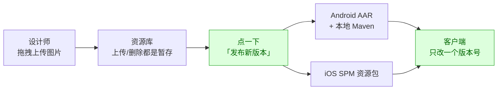
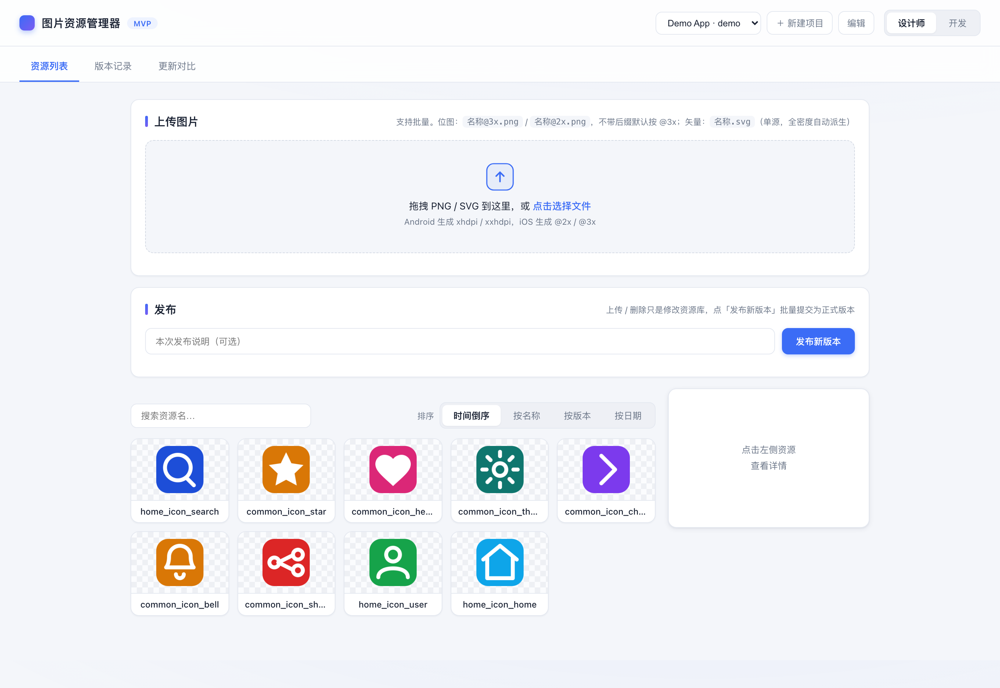
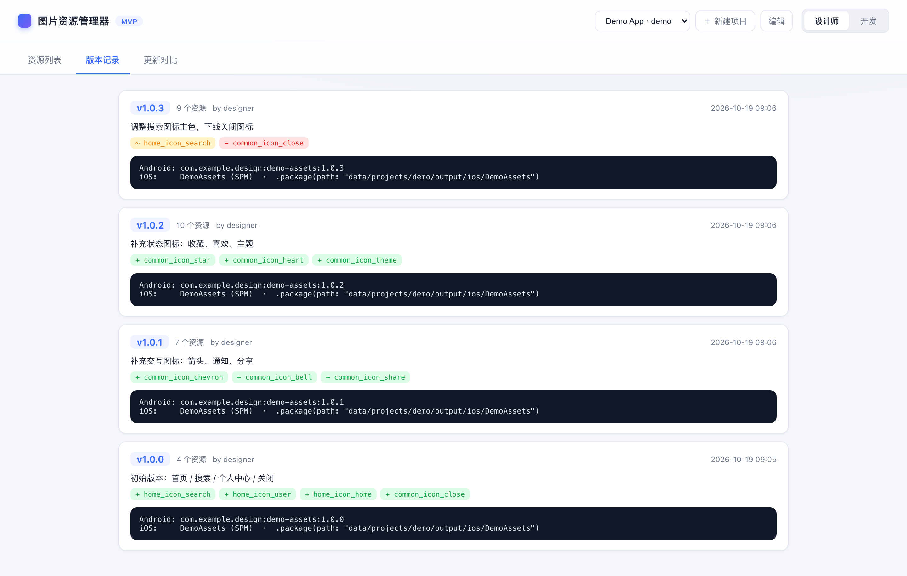

# 图片资源管理器

> 一句话说清这个项目：**设计师上传图片，平台一键打包出 Android AAR 和 iOS SPM 资源包，客户端改一个版本号就能拿到全部最新资源。**

> 📖 **本页是简版**（5 分钟看懂 + 跑起来）。
> 命名规则、SVG 矢量、客户端接入、部署运维、API 等完整内容 → **[详细版](docs/README-详细版.md)**

---

## 先讲一个场景

每个客户端团队都经历过这条「图片搬运流水线」：设计师在聊天工具里发表情包式地传压缩包，开发从网盘下载、手动拷进两端工程仓库，路上全是坑：**重名冲突、漏拷倍率、不知道哪张是最新版**。

一张图改一次，这条流水线就要重跑一遍。

## 这个工具把流水线砍成一条直线



设计师只做一件事：**传图、点发布**。剩下的——倍率派生、密度渲染、命名加前缀、打 AAR / SPM 包——全部自动。

| | 之前 | 之后 |
|---|---|---|
| 图怎么到客户端 | 聊天工具传压缩包，手动拷进工程 | 上传 → 发布 → 升级依赖 |
| 倍率图 | 手动导出、配对、命名 | 只传一档，另一档自动派生 |
| 图标重名冲突 | 各端自己加前缀，容易漏 | 平台统一按项目前缀生成物理名 |
| 「这图改没改过」 | 问人 | 任意两个版本一键 diff |

## 界面长什么样

打开就是工作台：上半部分拖图上传、点「发布新版本」，下半部分是资源列表：

<p align="center">
  
</p>

资源多了以后靠翻卡片找不到东西。顶部搜索框按名称即时过滤，右侧可切「时间倒序 / 按名称 / 按版本 / 按日期」四种排法，按版本排时还会自动分组，一眼看出「哪些是这一版新加的」：

<p align="center">
  
</p>

点任意卡片，右侧面板直接给出 Android / iOS 物理名、原始尺寸和倍率——开发不用再问设计要图。而且不只是「看」：物理名可一键复制，原图、Android PNG（或 VectorDrawable XML）、iOS imageset 按需下载；单色图标还能开着色预览试配色。删除是软删除——标记后发布新版本才生效，老版本 App 不受影响，随时可恢复：

<p align="center">
  
</p>

发布的每个版本都有完整记录——版本号、变更资源、依赖坐标一目了然：

<p align="center">
  
</p>

「这版和上一版差了什么？」不用再翻聊天记录，选两个版本直接对比：

<p align="center">
  
</p>

## 功能一览

| 环节 | 能做什么 | 谁用 |
|---|---|---|
| 上传 | 批量拖拽，支持 `@2x/@3x` 与 SVG；重名自动合并为同一资源的多倍率源 | 设计师 |
| 查找 | 名称搜索 + 时间/名称/版本/日期四种排序，按版本自动分组 | 双方 |
| 查看 | 两端物理名、原始尺寸、已有倍率、更新时间，物理名可复制 | 双方 |
| 修改 | 着色预览、单资源下载、软删除 / 恢复；项目级前缀与打包坐标可改 | 设计师 |
| 发布 | 一键生成 Android AAR（含本地 Maven）与 iOS SPM 资源包 | 设计师 |
| 追溯 | 版本记录 + 任意两版 diff（新增 / 修改 / 删除） | 双方 |

## 跑起来（两条命令）

```bash
npm install
npm start          # 打开 http://localhost:5173
```

`samples/` 里已放了一批示例图标（脚本绘制的纯矢量图，无第三方素材）；想重新生成就执行 `node scripts/gen-samples.js`。

前端是 **React 18 + antd 5**（源码在 `web/`），构建产物已提交到 `server/public/`，所以 `npm start` 不需要额外构建。改前端时：

```bash
npm run dev        # 后端，http://localhost:5173
npm run dev:web    # Vite 开发服务器，http://localhost:5174（/api、/uploads、/artifacts 代理到 5173）
npm run build      # 重新构建到 server/public
```

打开页面后，右上角切换角色，两条主线各走一遍：

| 角色 | 你能干什么 |
|---|---|
| 🎨 **设计师** | 拖图上传 → 搜索/查看/着色预览/删除 → 点「发布新版本」 |
| 💻 **开发** | 搜资源、看两端物理名与倍率、比任意两版差异、复制依赖坐标 |

---

## 想了解更多？

**[📖 打开详细版](docs/README-详细版.md)**，里面有：

1. 核心模型：项目 → 资源 → 版本
2. 资源生命周期：先暂存、再批量提交
3. 上传命名约定（倍率自动派生、SVG 矢量）
4. 产物与客户端接入（Android Gradle / iOS SPM 代码示例）
5. 命名映射规则
6. 部署到远程服务器
7. 批量导入与历史回填
8. 目录结构与 API
9. 已知限制与下一步
