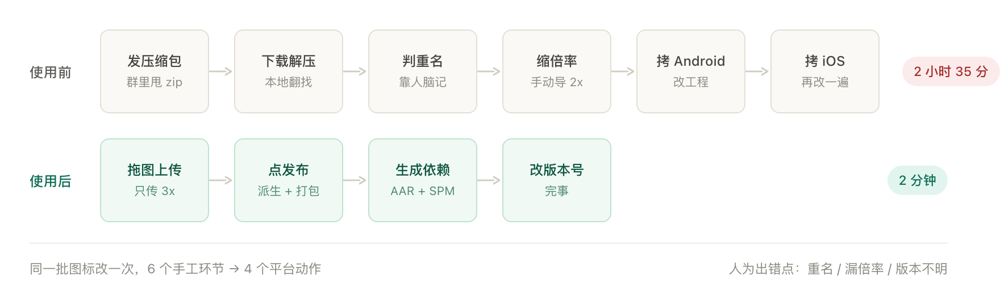
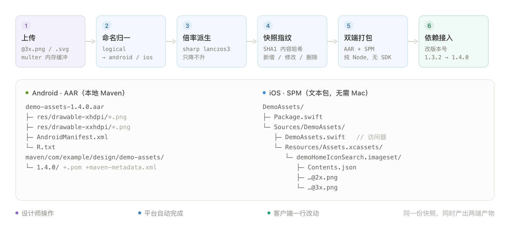

# 图片资源管理器

设计师传图，点一次发布，客户端改一个版本号。
Android AAR 与 iOS SPM 资源包自动生成——倍率、命名、打包都不用管。

## 使用前 · 使用后

<p align="center">
  
</p>

同一批图标改一次：**6 个手工环节、15 分钟** → **4 个平台动作、2 分钟**。

## 传图 · 发布

<p align="center">
  
</p>

拖进去，点「发布新版本」。只传一档倍率，另一档自动派生。

## 查找

<p align="center">
  
</p>

名称搜索，四种排序，按版本自动分组。

## 详情 · 修改

<p align="center">
  
</p>

两端物理名一键复制；原图、Android PNG、iOS imageset 直接下载；单色图标可着色预览，删除可恢复。

## 版本 · 对比

<p align="center">
  
</p>

<p align="center">
  
</p>

版本号、变更资源、依赖坐标一目了然；任意两版差异直接算出来。

## 它是怎么工作的

<p align="center">
  
</p>

上传 → 命名归一 → 倍率派生 → 快照指纹 → 双端打包 → 依赖接入。平台做的事全部在服务端完成，不需要 Android SDK，也不需要 macOS 构建机。

## 跑起来

```bash
npm install
npm start          # http://localhost:5173
```

React 18 + antd 5（源码在 `web/`），构建产物已提交，`npm start` 无需额外构建。

---

[详细文档](docs/README-详细版.md) · [技术设计](docs/技术设计-资源打包与发布.md)
