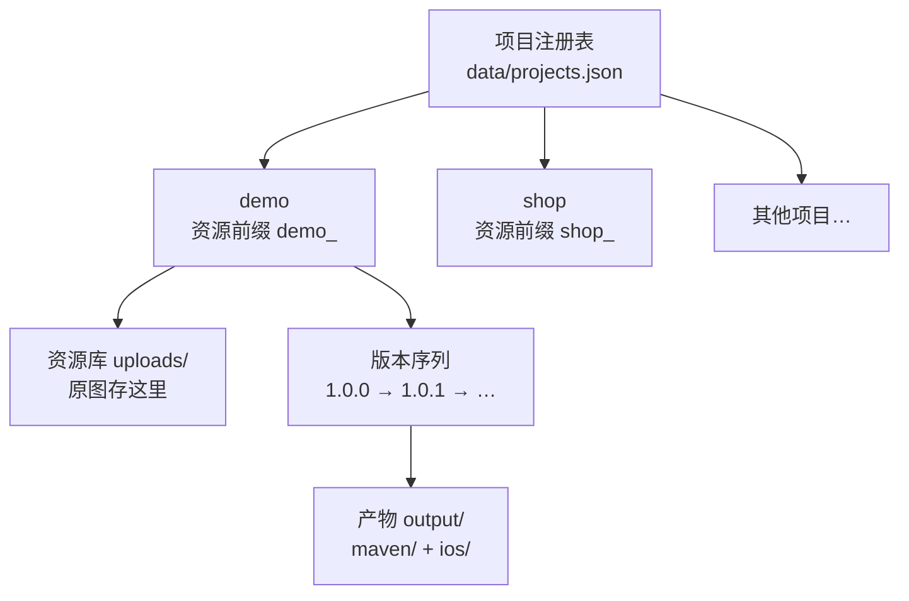
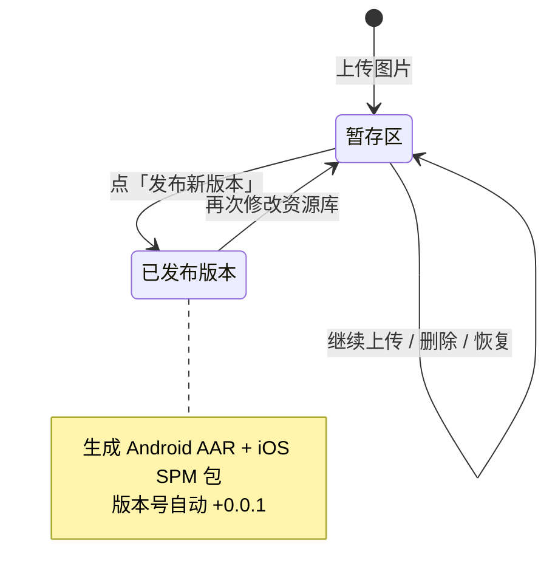
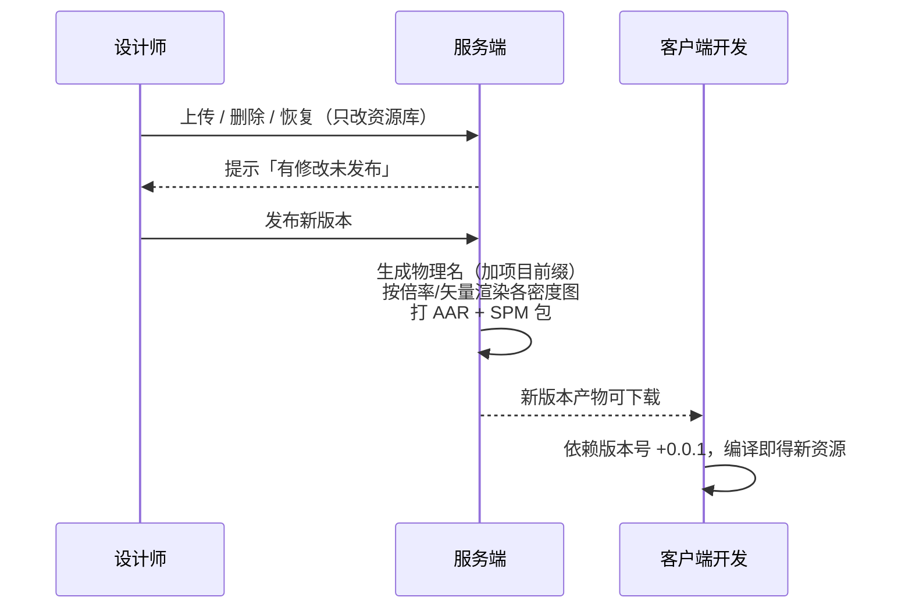
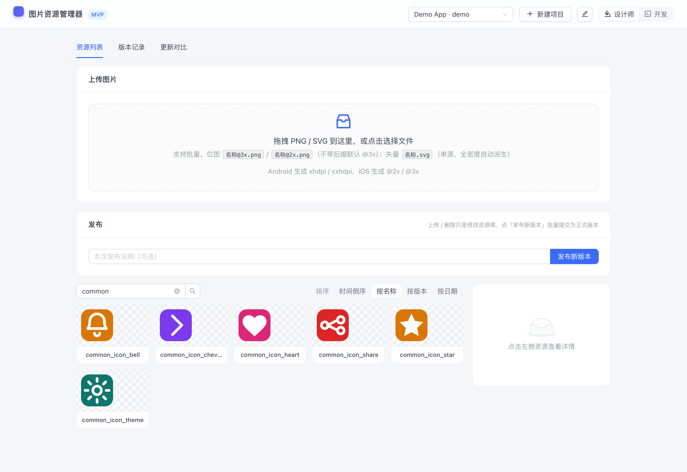
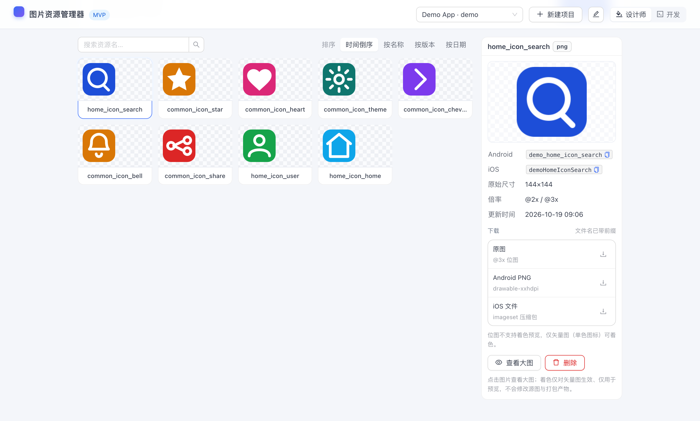
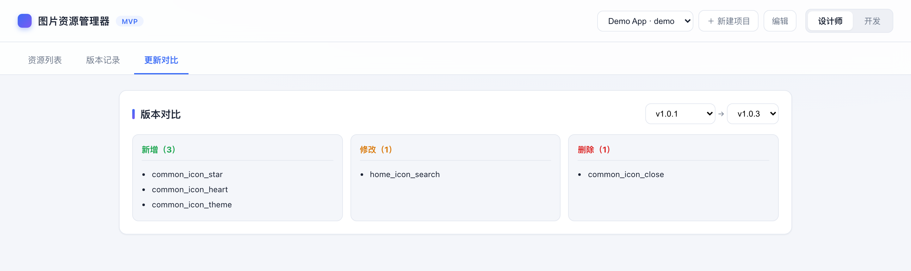

# 图片资源管理器 · 详细版

> 简版（项目是什么、怎么跑起来）见根目录 [README.md](../README.md)。本页是完整文档：核心模型、命名约定、客户端接入、部署运维、API。

---

### 0. 背景：一条被砍掉的流水线

每个客户端团队都经历过这条「图片搬运流水线」：设计师在聊天工具里发表情包式地传压缩包，开发从网盘下载、手动拷进两端工程仓库，路上全是坑——**重名冲突、漏拷倍率、不知道哪张是最新版**。一张图改一次，这条流水线就要重跑一遍。

| | 之前 | 之后 |
|---|---|---|
| 图怎么到客户端 | 聊天工具传压缩包，手动拷进工程 | 上传 → 发布 → 升级依赖 |
| 倍率图 | 手动导出、配对、命名 | 只传一档，另一档自动派生 |
| 图标重名冲突 | 各端自己加前缀，容易漏 | 平台统一按项目前缀生成物理名 |
| 「这图改没改过」 | 问人 | 任意两个版本一键 diff |

设计师只做「传图、点发布」，其余全部自动。

### 1. 核心模型：项目 → 资源 → 版本

一个 App 对应一个**项目**，项目之间完全隔离——各自的资源库、版本序列、打包坐标、数据目录互不可见：



每个项目的打包坐标（资源前缀、Maven `groupId/artifactId`、iOS 包名）都可以在 Web 面板里编辑；设计师角色可新建项目，顶栏随时切换。

### 2. 资源的生命周期：先暂存，再批量提交

这是理解这个工具的关键：**上传 / 删除 / 恢复都只是「修改资源库」（暂存），点「发布」才是批量提交**。发布时平台会对比资源库与最新版本，自动算出差异并生成产物。



一次完整发布的时序：



资源多了以后靠翻卡片找不到东西：顶部搜索框按名称即时过滤，右侧可切「时间倒序 / 按名称 / 按版本 / 按日期」四种排序，按版本排时自动分组：

<p align="center">
  
</p>

界面上，资源列表只展示图标与名称，点卡片在右侧面板看详情（Android / iOS 物理名、尺寸、倍率、更新时间）：

<p align="center">
  
</p>

面板里的操作分三类：

| 操作 | 说明 |
|---|---|
| 复制物理名 | Android / iOS 名字一键复制，直接贴进代码 |
| 下载 | 原图、Android PNG（矢量图为 VectorDrawable XML）、iOS imageset 压缩包，文件名已带前缀 |
| 修改 | 着色预览（仅矢量图/单色图标，纯展示，不影响源图与产物）、软删除 / 恢复（发布后生效，老版本 App 不受影响） |

「开发」角色可查看版本记录、任意两版 diff（新增 / 修改 / 删除）：

<p align="center">
  
</p>

### 3. 上传命名约定

设计师上传时不需要理解任何端上的规则，只需要在文件名里表达「逻辑名 + 倍率」：

**位图（PNG）**——文件名带倍率后缀：

| 文件名 | 逻辑名 | 说明 |
|---|---|---|
| `home_icon_search@3x.png` | `home_icon_search` | 3 倍图源 |
| `home_icon_search@2x.png` | `home_icon_search` | 2 倍图源 |
| `home_icon_search.png` | `home_icon_search` | 不带后缀默认按 @3x |

同一逻辑名可同时传 `@2x` 与 `@3x`；**只传其一，另一档自动按倍率派生**——设计师再也不用导两份图。

**矢量（SVG）**——单源、无倍率概念：

| 文件名 | 逻辑名 | 说明 |
|---|---|---|
| `home_icon_search.svg` | `home_icon_search` | 发布/打包时按目标密度栅格化为 PNG（AAR 双密度 + xcassets @2x/@3x） |

### 4. 产物与客户端接入

发布后产物在 `data/projects/<pid>/output/`，也可通过 `/artifacts/<pid>/` 在浏览器里浏览下载。以 `demo` 项目为例：

**Android** —— AAR + 本地 Maven 仓库：

```kotlin
// settings.gradle.kts
dependencyResolutionManagement {
    repositories {
        maven { url = uri("/绝对路径/data/projects/demo/output/maven") }
    }
}
// build.gradle.kts
dependencies {
    implementation("com.example.design:design-assets:1.0.1")
}
// 代码中使用
// imageView.setImageResource(R.drawable.demo_home_icon_search)
```

**iOS** —— SPM 资源包（Package.swift + Assets.xcassets，自动生成访问器）：

```swift
// Package.swift（或 Xcode 添加本地包）
.package(path: "/绝对路径/data/projects/demo/output/ios/DesignAssets")

// 代码中使用
import DesignAssets
imageView.image = DesignAssets.demoHomeIconSearch
```

### 5. 命名映射

物理资源名前缀取自项目配置（`demo` 为 `demo_`，新项目默认 `<项目ID>_`，可编辑）。Android 资源名全局唯一，统一加前缀避免冲突；iOS 转 camelCase 并加前缀：

| 逻辑名 | Android | iOS |
|---|---|---|
| `home_icon_search` | `demo_home_icon_search` | `demoHomeIconSearch` |

> 注意：修改项目资源前缀后，新物理名只对**之后发布的版本**生效，已发布版本保持不变。

### 6. 部署到远程服务器

以「局域网里的一台常开机器」为例：服务由 launchd（macOS）或 pm2 守护，开机自启。目标地址全部通过环境变量传入，脚本里不写死任何主机：

```bash
# 首次：配置免密登录（输入一次密码；已配过可跳过）
ssh-copy-id <user>@<host>

# 发布（rsync 同步代码 → npm install → launchd/pm2 重启 → 健康检查）
DEPLOY_HOST=<host> bash scripts/deploy.sh
# 服务器缺 node / rsync 时先执行
DEPLOY_HOST=<host> bash scripts/deploy.sh --setup
```

可选变量：`DEPLOY_USER`（默认当前用户）、`DEPLOY_PORT`（默认 5173）、`LAUNCHD_LABEL`（默认 `com.example.design.resource-manager`）。

发布后访问 `http://<host>:5173`。服务器上的 `~/client-resource-manager/data/` 是运行数据（上传图 / 版本库 / 产物），同步时始终排除，**不会被 `deploy.sh` 覆盖或删除**。

需要把本地的项目数据（比如演示项目）同步到服务器时，单独推一次，并先备份服务器上的旧数据：

```bash
ssh <user>@<host> 'mkdir -p ~/backups && tar czf ~/backups/data-$(date +%Y%m%d-%H%M%S).tar.gz -C ~/client-resource-manager data'
rsync -az --delete data/ <user>@<host>:client-resource-manager/data/
```

两个容易踩的点：

- **机器休眠**：默认空闲一段时间就睡，睡了服务就访问不到。要长期当服务器用，关掉休眠（macOS：`sudo pmset -c sleep 0`，仅接电源时永不睡）。
- **只有内网可达**：`192.168.x.x` 是私有网段，同一 Wi-Fi 能开，外网/4G 打不开；需要外网访问得再叠一层 Tailscale / frp 之类的隧道。

### 7. 批量导入与历史回填

`scripts/` 下有两个一次性导入工具，用于把已有图库搬进来：

| 脚本 | 用途 |
|---|---|
| `scripts/upload-batches.js` | 把原图目录分成 N 批，逐批「上传 + 发布」，生成 N 条版本记录。目录里出现 `.svg` 即按矢量模式处理 |
| `scripts/upload-history.js` | 在分批导入基础上，把各版本发布时间改写成指定历史日期，形成自然的迭代记录（需 SSH 到服务器，且目标项目发布记录为空） |

```bash
# 示例：把 data/import/demo-asset 分 10 批导入 demo
node scripts/upload-batches.js demo 10 data/import/demo-asset
```

### 8. 目录结构

```
server/
  index.js              Express 入口（按 project 托管 uploads / artifacts）
  config.js             端口、路径、新建项目默认坐标、密度策略
  lib/
    naming.js           逻辑名 → 三端物理名映射 + 校验
    image.js            sharp 封装：探测尺寸、按倍率渲染、SVG 栅格化
    vector-drawable.js  SVG → Android VectorDrawable XML
    snapshot.js         资源快照 + 版本 diff
    export.js           单资源导出（原图 / VectorDrawable / imageset 压缩包）
    store.js            项目注册表 + 每项目 JSON 元数据存储（MVP 用，可换 PostgreSQL）
  packagers/
    android.js          生成 AAR + 落地本地 Maven 仓库
    ios.js              生成 SPM 资源包（Package.swift + Assets.xcassets）
  routes/api.js         项目管理 + 上传 / 发布 / 版本 / diff 接口
  public/               Web 面板构建产物（Vite 输出，Express 直接托管）
web/
  index.html            前端入口
  src/
    main.jsx            React + antd 挂载（ConfigProvider / 主题 / 中文语言包）
    App.jsx             页面骨架与项目、角色、标签页状态
    api.js              接口封装 + 预览地址、排序分组、下载等纯函数
    theme.js            antd 主题 token（品牌色 / 圆角 / 字体）
    styles.css          少量布局样式（资源网格、预览棋盘底、着色遮罩）
    components/         TopBar / UploadCard / PublishCard / AssetGrid /
                        AssetDetail / Lightbox / ReleasesPanel / DiffPanel / ProjectModal
vite.config.js          Vite 配置（root=web，产物输出到 server/public）
scripts/
  gen-samples.js        生成示例 PNG
  upload-batches.js     分批导入（支持 SVG 矢量模式）
  upload-history.js     分批导入 + 历史日期回填
  deploy.sh             远程部署
data/
  projects.json         项目注册表
  projects/<id>/        每项目：db.json + uploads/（原图） + output/（产物）
  import/               批量导入用的原图目录（可选）
```

### 9. API

所有资源操作都挂在项目作用域下（`:pid` 为项目 ID）：

| 方法 | 路径 | 说明 |
|---|---|---|
| GET | `/api/projects` | 项目列表（含资源数 / 版本数 / 最新版本） |
| POST | `/api/projects` | 新建项目（`{ id, name?, prefix?, groupId?, artifactId?, iosPackage? }`，缺省自动推导） |
| PATCH | `/api/projects/:pid` | 编辑项目（名称 / 前缀 / 打包坐标） |
| GET | `/api/projects/:pid/state` | 全量状态（项目配置 + 资源 + 版本 + 待发布修改 `pending`） |
| POST | `/api/projects/:pid/assets` | 批量上传（multipart，字段 `files`） |
| POST | `/api/projects/:pid/assets/:logical/remove` | 删除资源（软删除，发布新版本后从新版本中移除） |
| POST | `/api/projects/:pid/assets/:logical/restore` | 恢复 |
| POST | `/api/projects/:pid/publish` | 发布新版本（构建该项目的三端产物） |
| GET | `/api/projects/:pid/releases` | 版本列表（倒序） |
| GET | `/api/projects/:pid/diff?from=&to=` | 两版差异（新增 / 修改 / 删除） |
| GET | `/api/projects/:pid/assets/:logical/download?kind=` | 单资源下载，`kind=source`（原图）/`android`（矢量→VectorDrawable XML，位图→@3x PNG）/`ios`（imageset 压缩包）。文件名用三端物理名，可直接放进工程 |

静态资源同样按项目隔离：原图 `/uploads/<pid>/...`、产物 `/artifacts/<pid>/...`。

> `db.json` 里的源图与产物路径存「相对 `data/` 目录」的路径，读写在 `server/lib/store.js` 里自动转换。
> 这样 `data/` 可以整体搬到另一台机器（部署 / 备份恢复）而不失效。

### 10. 已知限制（下一步）

- 元数据用 JSON 文件存储，多人并发需换 PostgreSQL。
- Android 走「免 SDK 的纯 Node 打包」（适合纯资源库）；若库内要放 Kotlin 代码，需切到 Gradle 构建（`packagers/android.js` 已预留 `generateGradleModule`）。
- iOS 目前生成本地路径依赖；生产环境应推送到私有 Git / SPM registry。
- 尚未接入权限体系（角色目前是前端切换）、项目删除、审计日志、发布通知。
- 修改项目资源前缀后，物理名变更只对之后发布的版本生效（见第 5 节）。

更完整的设计背景见 [docs/图片资源管理器-规划方案.md](图片资源管理器-规划方案.md) 与 [docs/技术设计-资源打包与发布.md](技术设计-资源打包与发布.md)。
